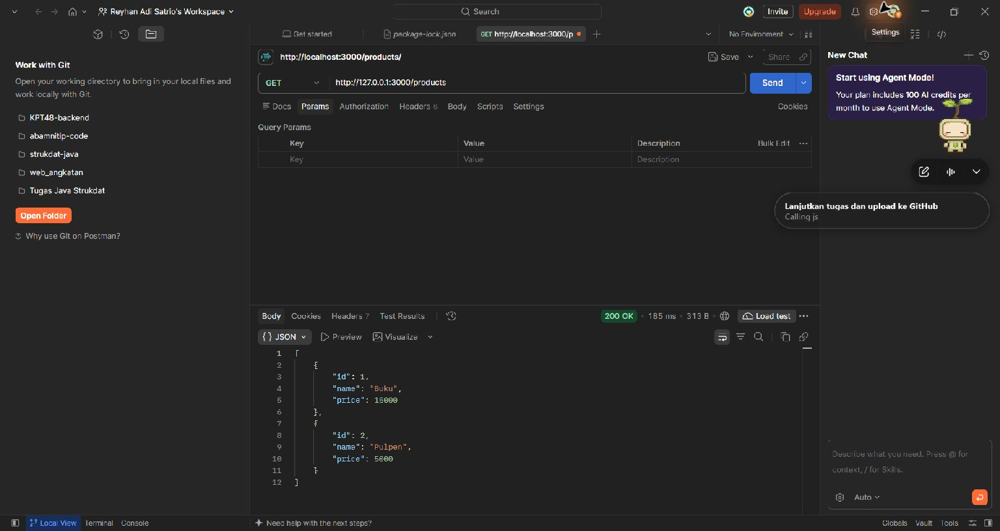
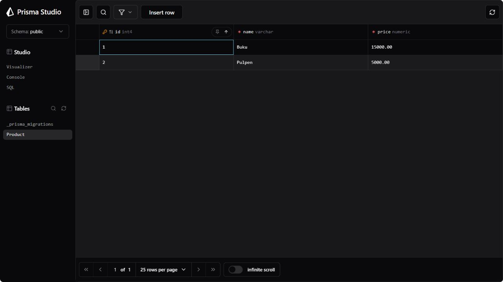
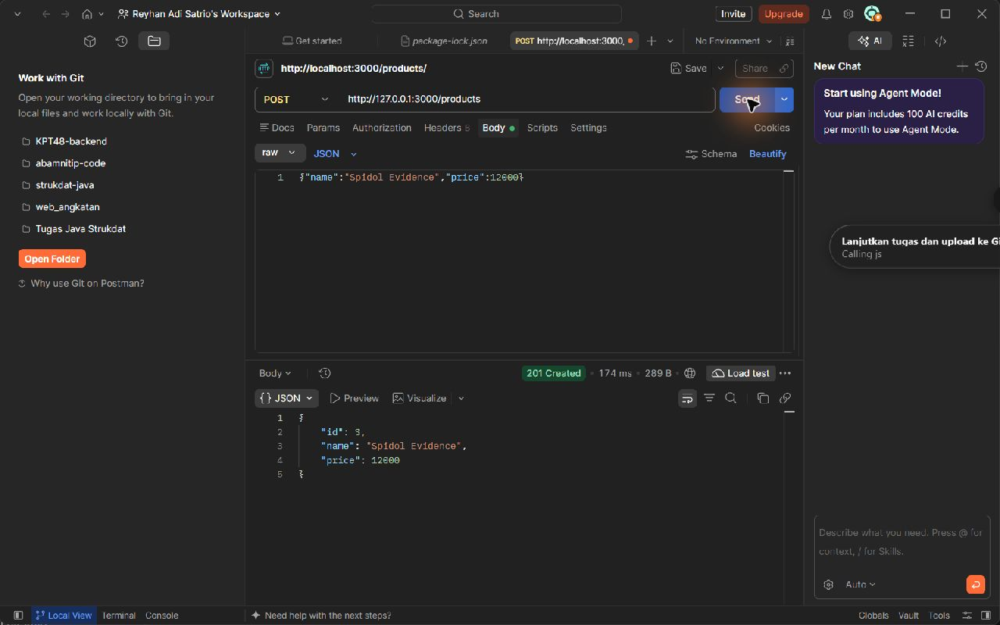
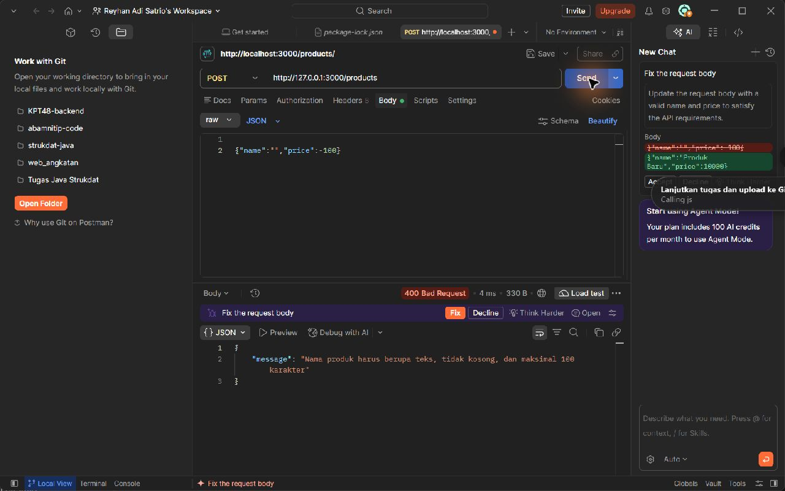
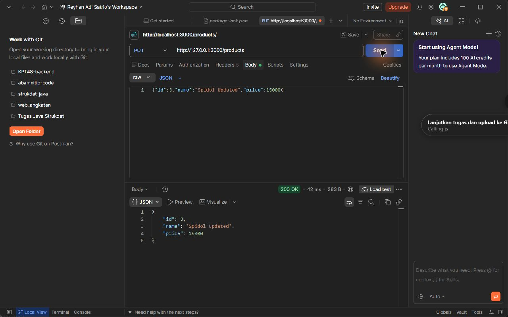
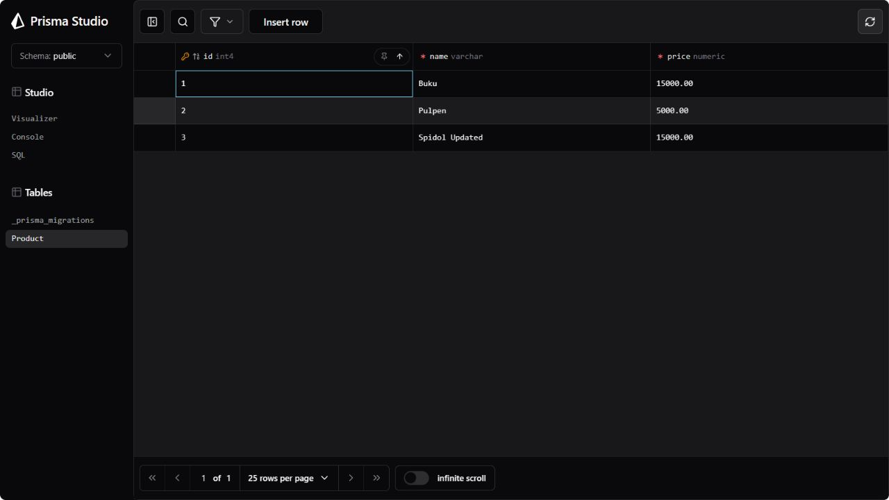
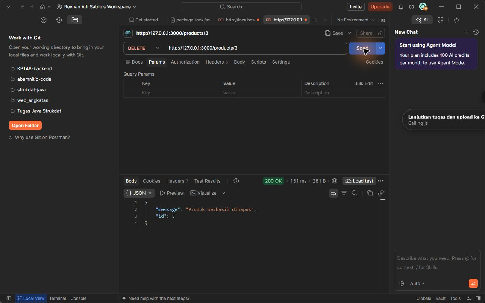
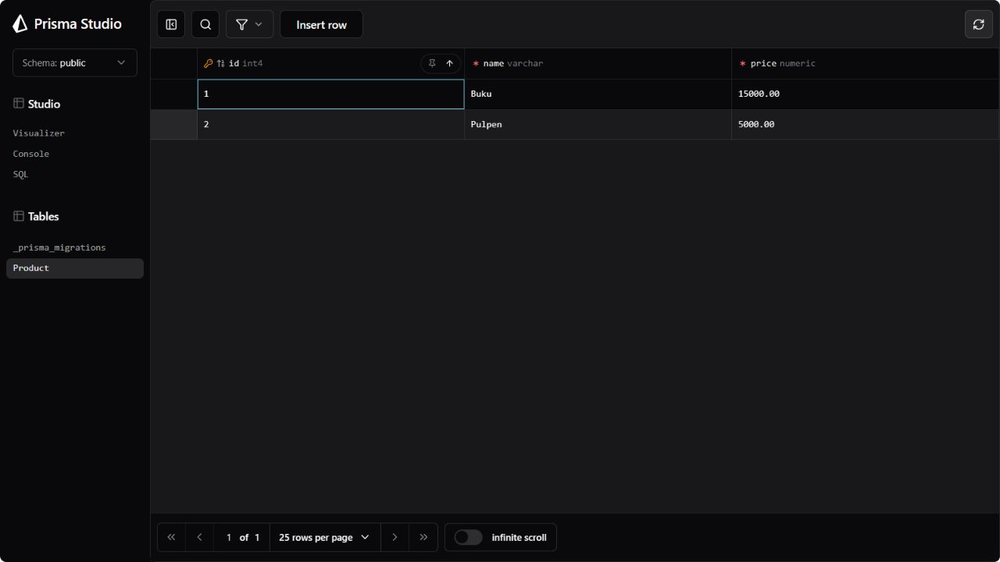
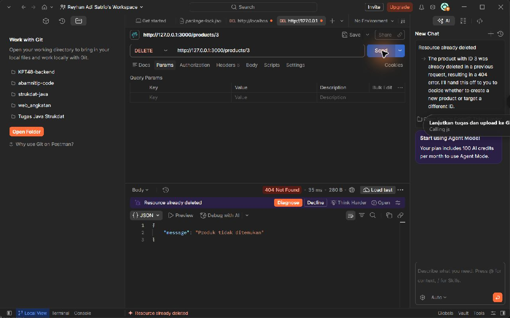

# Laporan Evidence - Pemrograman Web Minggu 10

Nama: Reyhan Adi Satrio

NRP: 5027251080

Tanggal pengujian: 7 November 2026

Repository: [pemweb-tugas-10-prisma](https://github.com/Rehangg26/pemweb-tugas-10-prisma)

API produk minggu ke-9 dilanjutkan dengan Prisma 7 dan PostgreSQL. GET dan POST memakai database; PUT dan DELETE ditambahkan. PUT menggunakan `id`, `name`, dan `price` di body. ID dibuat otomatis oleh PostgreSQL.

## Lingkungan dan metode

Node.js 24.16.0, Express 5.3.0, Prisma 7.10.1, dan PostgreSQL 18.6 lokal. Request manual dijalankan di Postman Desktop. Perubahan tabel diperiksa langsung melalui Prisma Studio. Screenshot berikut adalah hasil pengujian langsung, bukan contoh response buatan.

Database `products` digunakan untuk evidence manual. Database `products_test` digunakan untuk tes integrasi otomatis agar data latihan tidak terganggu.

## 1. GET seluruh produk

Request `GET /products` menghasilkan `200 OK`, berupa array produk Buku (ID 1, harga 15000) dan Pulpen (ID 2, harga 5000).

## 2. POST berhasil dan perubahan database

Kondisi sebelum POST: tabel Product memiliki dua baris.

Request `POST /products` dengan body `{"name":"Spidol Evidence","price":12000}` menghasilkan `201 Created`. Response berisi ID 3 yang dibuat otomatis.

Sesudah POST, Prisma Studio menunjukkan baris ketiga: ID 3, Spidol Evidence, harga 12000.00. Ini membuktikan POST menulis ke PostgreSQL.

## 3. Kesalahan validasi

Request POST dengan body `{"name":"","price":-100}` ditolak dengan `400 Bad Request`. Pemeriksaan nama kosong berjalan terlebih dahulu dan mengirim pesan validasi nama. Harga negatif juga diuji secara terpisah pada tes otomatis. Request gagal ini tidak membuat produk baru.

## 4. PUT berhasil dan perubahan database

Sebelum PUT, ID 3 bernama Spidol Evidence dengan harga 12000.00 (lihat screenshot sesudah POST). Request `PUT /products` memakai body `{"id":3,"name":"Spidol Updated","price":15000}` dan menghasilkan `200 OK`.

Sesudah PUT, baris dengan ID yang sama berubah menjadi Spidol Updated dengan harga 15000.00. Jumlah baris tetap tiga.

## 5. DELETE berhasil dan perubahan database

Sebelum DELETE, ID 3 masih ada (lihat screenshot sesudah PUT). Request `DELETE /products/3` menghasilkan `200 OK` dengan pesan `Produk berhasil dihapus` dan ID 3.

Sesudah DELETE, ID 3 tidak ada lagi di Prisma Studio. Tabel kembali berisi dua produk awal.

## 6. Produk tidak ditemukan

Request `DELETE /products/3` dijalankan kembali sesudah produk terhapus. Server mengirim `404 Not Found` dengan pesan `Produk tidak ditemukan`.

## 7. Pengujian otomatis dan persistence

`npm test` menghasilkan **39 pemeriksaan lulus, 0 gagal**. Tes mengirim request HTTP ke Express dan memeriksa isi PostgreSQL menggunakan Prisma, tanpa database mock.

Skenario yang diperiksa mencakup GET daftar/detail, POST valid, nama kosong/terlalu panjang/bukan teks, harga string/negatif/terlalu besar/pecahan tidak valid, PUT berhasil, ID body salah atau tidak diisi, GET/PUT/DELETE tidak ditemukan, path ID salah, JSON rusak, DELETE berulang, dan endpoint tidak ada.

Untuk persistence, tes membuat produk, menghentikan proses Express, menjalankan proses Express baru, lalu membaca produk yang sama. Produk tetap ditemukan dan nilainya sama. Harga batas maksimum 9999999999.99 juga diuji agar tidak kehilangan presisi.

Log lengkap tersedia di [test-results.txt](test-results.txt). Pengujian manual dan otomatis menunjukkan operasi API tersimpan di PostgreSQL dan ditangani dengan status HTTP yang sesuai.
